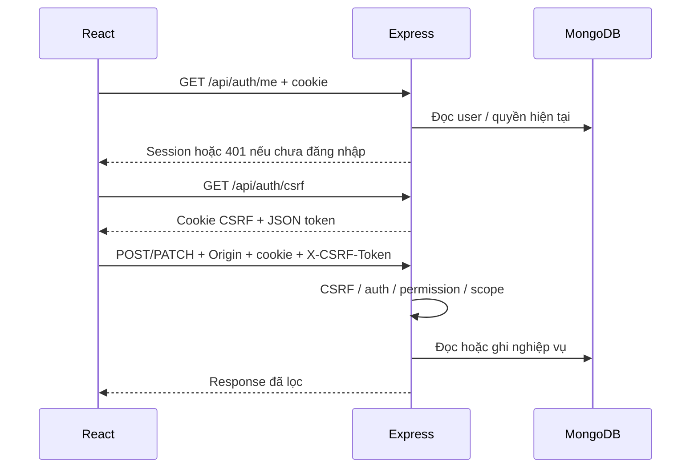

# Luồng xử lý từ UI tới dữ liệu

Các đường dẫn source dưới đây là điểm bắt đầu đọc. Tên người dùng/config trong ví dụ là giả.

## 1. Session và mutation



Đọc [auth.jsx](../client/src/auth.jsx) → [api.js](../client/src/api.js) → [auth route](../server/src/routes/auth.js) → [middleware auth](../server/src/middleware/auth.js). Chi tiết bảo mật trong [spec auth](auth-rbac-spec.md).

401 ở `/me` trước login là bình thường; 502 ở endpoint CSRF là lỗi proxy/backend, chưa phải token không khớp. CSRF origin sai là 403 ở mutation.

## 2. Sửa một config

[AccountConfigPage](../client/src/pages/AccountConfigPage.jsx) → PATCH `/api/bots/bot-demo/configs/DEMO_1` → [bots route](../server/src/routes/bots.js) → `getConfigDetail` trước sửa → `updateConfigSummary` trong [account-config-view](../server/src/lib/account-config-view.js) → kiểm tra bot/scope/env → `$set` field hợp lệ vào `account_configs` → diff/audit → response.

Bot giao dịch đọc cấu hình ở process riêng. Không nối mũi tên từ response lưu config sang “đã đổi lệnh trên sàn”. Bulk và thao tác Signal có danh sách lỗi từng env, không phải transaction tất cả hoặc không có gì.

**Đồng bộ runtime** ([contract](bot-command-bridge.md)):

| Use case web | Sau Mongo | MQTT |
|---|---|---|
| Sửa config / bulk / signal | `APPLY_CONFIG` | `config/sync` reload (env đã load) |
| Thêm / copy account mới | `LOAD_ACCOUNT` | `account_runtime` load vào RAM + handler |
| Gỡ account | `UNLOAD_ACCOUNT` | unload RAM (không xóa Mongo lần 2) |
| Đổi tên env | `RENAME_ACCOUNT` | unload cũ + load mới |

Chỉ báo “đã đồng bộ” khi outbox terminal succeeded (TRADER đủ `requiredRoles`). Bot ghi ACK Mongo theo `requestId`; UI poll/wait `GET .../commands/:requestId`. Offline → chờ đồng bộ + retry. MQTT `command_response` chỉ phụ.

Config: `/config-lab` → GET `/api/bots/assigned-configs` → tạo/bulk/xoá account hoặc mở
`/config-lab/:username/:env` (AccountConfigPage). Route cũ `/bots/:user` và
`/bots/:user/accounts/:env` redirect sang đây. Danh sách `/bots` chỉ Active/phạm vi/chủ + peek.
`configDraft` chuẩn hóa/diff; PATCH chỉ field đổi. Bộ lọc list nằm trong URL.

## 3. Tìm rồi copy/sync config

[SignalSearchPage](../client/src/pages/SignalSearchPage.jsx) → GET `/api/bots/config-search` → [config-search](../server/src/lib/config-search.js) → lọc bot được phép, account_configs + account_statics → bảng hiệu suất → popup GET config/Static → POST `/:username/configs/:env/copy` → [copyAccount](../server/src/lib/bot-directory.js) → ghi config đích và liên kết account → audit `config.copied`.

Phân biệt mode new/replace/sync. User xem được nguồn chưa chắc sửa được đích. Tab Thống kê/Cấu hình Signal gọi [signal-setup](../server/src/lib/signal-setup.js), không đi qua config-search.

**Provider Scorecard** (`tab=scorecard`): [SignalScorecardPanel](../client/src/pages/SignalScorecardPanel.jsx) → GET `/api/provider-scorecard` → [provider-scorecard](../server/src/lib/provider-scorecard.js) → đếm feed `signal_infos` (nếu `signals.history`) + group trades `account_statics` theo `typeSignal` trong scope bot (nếu `statistics.view`) → gắn cờ channel từ `telegram_clients` → bảng xếp hạng. Không ghi Mongo. Chi tiết [spec](provider-scorecard-spec.md).

## 4. Position live

`PositionsPage` (`/positions`) và `TerminalPage` (`/terminal`) dùng chung REST/WS/refresh/case/trading. Terminal thêm URL `tab=positions|open-orders|…`, `selected`, `panelTab`, `book=live` (adapter → API không gửi book), preferences localStorage namespace Terminal. Không có pipeline trading thứ hai.

```mermaid
flowchart TD
    Page[PositionsPage / TerminalPage] --> Fast[GET /api/positions?mode=fast]
    Fast --> Paint[Mongo + Redis paint]
    Page --> WS[/api/positions/ws]
    WS --> FastView[snapshot mode=fast]
    WS --> Watch[watch → reconcileLive nền]
    Watch --> LiveAPI[positionRisk + openOrders + algoOrders]
    LiveAPI --> Redis[(wb:ex Redis)]
    Redis --> Patch[WS snapshot patch]
    Page --> Refresh[POST /refresh]
    Refresh --> LiveOnly[Live queue: 1 account · position → orders → algo]
    Page --> Case[Mở Chi tiết / case reconcile]
    Case --> Details[income + history + trades · cache 3 phút]
```

Source: [position-ws](../server/src/lib/position-ws.js), [position-live](../server/src/lib/position-live.js), [position-cache](../server/src/lib/position-cache.js), [positions](../server/src/lib/positions.js), [binance-rest-queue](../server/src/lib/binance-rest-queue.js).

**Paint trước, sync sau:** `mode=fast` (mặc định GET) chỉ đọc Mongo monitor + Redis `wb:ex` — không gọi Binance. WS gửi snapshot fast ngay; `reconcileLive` chạy nền (MQTT ưu tiên, fallback REST liveOnly), ghi Redis, publish notify → client patch theo account.

**REST Binance (web):** hàng đợi chung — một request signed tại một thời điểm, giãn ~400ms (tăng khi 429). Trong một account: `positionRisk` trước, rồi `openOrders`, rồi `openAlgoOrders`. Refresh nhiều account: concurrency 1, gap ~400ms giữa account. `POST /refresh` luôn live-only. Income / positionHistory / userTrades chỉ khi mở Chi tiết / case reconcile (`details:true`), cache 3 phút, giãn từng symbol.

Redis `wb:ex:<account>` là sổ vị thế sàn; `wb:pos` chỉ bổ sung monitor, không thay danh sách sàn. `wb:bal:<ENV>` là availableBalance + wallet/total do binance-bot AccountMonitor ghi (Config Lab ước lượng RATIO). Redis **không** lưu tên signal kênh (ROSE/BULL…) — signal nằm Mongo `account_configs` / `signal_infos`. Binance-bot áp dụng ACCOUNT_UPDATE vào đúng symbol + positionSide: qty=0 xóa dòng, không ảnh hưởng vị thế khác. Delta chưa có baseline mang `complete:false`; REST bổ sung baseline. Snapshot sàn `positions:[]` là kết quả hợp lệ, không phục hồi monitor đã đóng từ dữ liệu cũ.

Bot và web dùng cùng Lua protocol `exchange-book.lua`: đọc `wb:ex:<account>:ver` **trước** REST, chỉ ghi khi version còn khớp; cập nhật sổ, tăng version và publish `wb:ex:notify:<account>` trong một thao tác nguyên tử. Delta có timestamp theo từng vị thế để bỏ sự kiện trùng/cũ. REST đầy đủ (kể cả `positions:[]`) đánh tombstone các symbol không còn trong sổ để delta trễ không làm sống lại vị thế đã đóng. ACCOUNT_UPDATE của bot chỉ gọi REST bổ sung khi sổ còn `complete:false`; sổ đã đủ thì chỉ vá Redis từ sự kiện. Các bản Lua ở hai repo phải giống nhau. Cần cập nhật cả bot lẫn web khi triển khai; process phiên bản cũ còn ghi Redis sẽ không tuân theo fence này.

Đọc `wb:ex` gia hạn TTL 20 phút để trang đang xem không để sổ hết hạn. Khi có watcher, `reconcileLive` nếu sổ >30s; timer nền theo `EXCHANGE_REFRESH_MS`. Lỗi API thường thì nhả lease ngay; chỉ 429 giữ lease/cooldown. API lỗi giữ lease đến hết hạn; 429 dùng cooldown chung tối thiểu 120 giây và tôn trọng Retry-After. Không có Redis chỉ deduplicate trong một process.

WebSocket hỗ trợ account cụ thể và account rỗng (Tất cả) trong phạm vi quyền. Server đọc lại session/user trước mỗi snapshot, serialize việc dựng view và bỏ kết quả của subscription cũ. `pause`/đóng socket bỏ watchers, watcher cuối dừng timer REST. Trình duyệt ẩn tab sẽ pause; socket không có snapshot trong 30 giây thì HTTP fallback `mode=fast`. REST/WS đến muộn không ghi đè push version mới hơn.

`sources[]` trả account/version/checkedAt/stale; `checkedAt` lấy từ `reconciledAt`, độc lập thời điểm delta (`positionsAt`) và giá mark. Không có baseline hoặc quá 90 giây chưa đối chiếu thì báo cũ, kể cả socket/giá còn chạy. Snapshot cũ vẫn hiện kèm cảnh báo. Giá public chỉ phủ mark/PnL, không cập nhật freshness vị thế. `wb:ord` giữ luồng order hiện có.

REST dùng `account`, `audience`, `book` và các filter; chi tiết monitor dùng `/api/positions/detail?id=...`. Phân quyền không được bỏ qua vì dữ liệu lấy từ cache. Đọc [giới hạn WS](architecture.md#giới-hạn-hiện-tại) trước khi sửa auth/proxy.

## 5. Tổng kết và cache

[SummaryPage](../client/src/pages/SummaryPage.jsx) → [summary route](../server/src/routes/summary.js): nhánh snapshot hệ thống hoặc [system-summary](../server/src/lib/system-summary.js) theo actor → aggregate Mongo → response.

[summary-snapshots](../server/src/lib/summary-snapshots.js) dùng lease Mongo tránh nhiều process tính cùng range. Scheduler kiểm tra mỗi 60 giây. Ranges: today/3d/7d/30d/90d/all; freshness 2 phút, riêng all 15 phút; lease 2 phút. Không có payload và process khác đang tính có thể trả 503; refresh cưỡng bức không lấy được payload có thể trả 409. Version công thức nằm trong module; không dùng snapshot khác version như kết quả hiện tại.

`web_summary_cache` là lớp cache riêng trong system-summary, không đồng nghĩa `web_summary_snapshots`. Khi lần theo một request phải xem route thực sự gọi hàm nào, không chỉ thấy model tồn tại.

## 6. Lãi lỗ ví và AI

[AccountLedgerPage](../client/src/pages/AccountLedgerPage.jsx) → GET `/api/account-ledger` đọc DB. Nút refresh → POST `/:username/refresh` → [refreshLedger](../server/src/lib/account-ledger.js) → kiểm tra scope → lấy credential phía server → Binance balance/income ngày UTC → ghi `futures_profits` → UI đọc kết quả. Không trả API key cho browser.

[DashboardPage](../client/src/pages/DashboardPage.jsx) → GET `/api/dashboard` → [dashboard](../server/src/lib/dashboard.js): bot scope + config ON + profit/closed hôm nay (`account_statics`) + income (`futures_profits`) + heartbeat theo `run` + uPnL/top vị thế từ Redis `readExchangeBooks` (không REST). Attention gắn severity. POST `/api/dashboard/attention` → [dashboard-ai](../server/src/lib/dashboard-ai.js) gọi lại `getDashboard` → [dashboard-brief](../server/src/lib/dashboard-brief.js) → provider AI → parse gợi ý, giới hạn link theo facts. Thử tối đa hai provider, timeout 12 giây; route giới hạn 15 giây/user.

## 7. Deploy

`npm run update` → kiểm tra checkout/upstream → git pull fast-forward → chạy deploy vừa pull → npm ci server/client → test server → build client → restart riêng PM2 web-bot → health loopback → copy asset, thay index.html cuối → pm2 save.

Build/dependency lỗi dừng trước restart theo luồng script; health lỗi giữ frontend cũ nhưng backend/dependency có thể đã đổi. Xem [runbook Debian](deploy-debian.md); không coi pull thành công là deploy thành công.
