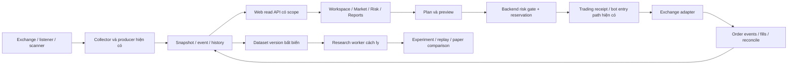

# Quant Trading Terminal — master spec

Ngày: 2026-11-01. Trạng thái: **đề xuất triển khai, chưa phải mô tả tính năng đã hoàn thành**.
Phạm vi: web-bot + các producer, risk gate và research runner cần thiết trong binance-bot.
Tất cả module dưới đây đều thuộc roadmap đã chọn; chia milestone để triển khai và nghiệm thu, không loại module ưu tiên sau.

## 1. Mục tiêu sản phẩm

Một vòng làm việc hoàn chỉnh: **quan sát thị trường → tìm cơ hội → lập kế hoạch → kiểm tra rủi ro → thực thi → theo dõi → đánh giá → kiểm định và cải thiện strategy**.

Ba nhóm sử dụng: trader thủ công, người vận hành copy-trade/scanner và người nghiên cứu strategy. Cùng dùng dữ liệu có nguồn gốc và identity thống nhất, nhưng không đánh đồng phân tích với lệnh giao dịch.

Hoàn thành khi người dùng có thể:

1. Chọn signal/coin, xem chart và bối cảnh, tạo draft lệnh mà không nhập lại symbol/setup.
2. Biết exposure và rủi ro của account lẫn phần từng config sở hữu trước khi gửi lệnh.
3. Lần theo signal bị bỏ qua hoặc một lệnh từ đầu đến cuối, đối soát với fill sàn.
4. Thử nghiệm config/strategy có phiên bản trên dữ liệu lịch sử, kiểm định ngoài mẫu, chạy paper rồi so sánh live.
5. Phân bổ vốn và dùng execution nâng cao với giới hạn rủi ro được thực thi ở backend.

Không dùng win rate, số indicator, số panel hay lời giải thích AI làm tiêu chí hoàn thành.

## 2. Baseline và tài liệu phải kế thừa

Đã khảo sát source và tài liệu local; chưa kiểm chứng production. Phải audit lại call graph khi implement vì code có thể đổi sau ngày spec.

| Nền hiện có | Điểm nối | Cách phát triển |
|---|---|---|
| Terminal, filters, prefs, position feed, mutation dialogs | `client/src/pages/TerminalPage.jsx`, `client/src/components/terminal/` | Mở rộng workspace, giữ URL và các thao tác cũ |
| Market/Limit/Stop/Stop Limit, sizing | `client/src/components/OrderTicket.jsx`, `terminal/sizing.js` | Thêm preview có phiên bản, quote freshness, plan và chart interaction |
| Trading receipt + direct exchange adapter | `server/src/routes/trading.js`, `lib/trading-bridge.js`, `lib/direct-trading.js`, `lib/exchanges/` | Tái sử dụng mutation path; capability theo từng sàn |
| Market kỹ thuật, Dashboard, Smart Money | `pages/MarketHubPage.jsx`, `MarketDashPage.jsx`, `SmartMoneyPage.jsx`; `server/src/lib/market/`, `market-dash/`, `smart-money/` | Dùng collector chung; không tạo fetch sàn riêng cho từng widget |
| Scorecard, performance, ledger | `SignalScorecardPanel.jsx`, `TradePerformancePage.jsx`, `AccountLedgerPage.jsx` | Thêm định nghĩa metric nhất quán, attribution và dữ liệu coverage |
| Journal, AI decision support | `routes/terminal.js`, `models/trade-journal.js`, `lib/decision-support/` | Nâng liên kết theo vòng đời trade; không xây journal thứ hai |
| Config Lab và config apply | `ConfigLabPage.jsx`, `docs/config-lab-spec.md`, `docs/bot-command-bridge.md` | Config Lab quản lý cấu hình; Research Lab quản lý experiment |
| Fill/order event | `models/exchange-fill.js`, `models/exchange-order-event.js` | Bổ sung exchange/instrument và correlation tương thích legacy |
| Backtest trong bot | `services/backtest/`, `services/dca-mtf-bot/backtest/backtest-engine.js`, `scripts/dca-mtf-backtest.js` | Audit độ tương thích, bọc runner; không giả định engine hiện có đã đủ fidelity |

Tài liệu phụ thuộc:

- [Architecture](architecture.md), [flows](flows.md), [API/data](api-data-reference.md), [development](development.md).
- [Terminal workspace](terminal-workspace-spec.md), [R1 gaps](terminal-r1-gaps-spec.md), [R2 tools](terminal-r2-tools-spec.md), [Trading terminal](trading-terminal-spec.md).
- [Market Intelligence](market-intelligence-spec.md), [Market formula](market-formula-v1.md), [Decision list](market-decision-list-spec.md).
- [Research tracking & Inbox](research-tracking-inbox-spec.md): giữ semantics theo dõi setup; không chiếm route `/research` cho backtest.
- [Provider scorecard](provider-scorecard-spec.md), [AI decision support](ai-decision-support-spec.md).
- [Multi-exchange](multi-exchange-futures-spec.md), [auth/RBAC](auth-rbac-spec.md) và AGENTS/rules của cả hai repo.

Spec này bổ sung phạm vi sản phẩm, không âm thầm thay protocol hay semantics trong các spec authoritative. Khi phát hiện xung đột, ghi quyết định và sửa contract/test liên quan trước implementation.

## 3. Kiến trúc và invariant

### 3.1 Chuỗi dữ liệu

- Web trading: UI → `/api/trading/*` → trading receipt → direct-trading → adapter. Không chuyển các lệnh này sang config MQTT bridge.
- Config: Mongo → outbox APPLY_CONFIG → MQTT wakeup → ACK bền. Publish thành công không phải applied.
- Bot trading: listener/scanner → signal handler/MTF entry → gate trước side effect tăng exposure → order path hiện có.
- Worker research không khởi động `index.js` của trader, không nhận credential live, không có quyền gọi endpoint giao dịch.
- Collector phải dùng rate limiter/cache hiện có; WS có sequence/gap recovery, REST fallback có backoff.

### 3.2 Identity và tiền

- `actorId`: user web; `botUsername`: user-api/RUN; `env`: config. Không dùng lẫn ba khái niệm.
- Identity thị trường: `exchange + marketType + instrumentId`; symbol chỉ để hiển thị/tương thích.
- Identity vị thế: account sàn + market identity + side + positionIdx nếu có. Config attribution thêm env/monitorId; không cộng lại qty sàn cho từng monitor.
- Thêm `tradeInstanceId` cho một vòng mở→đóng; `signalEventId`, `planId`, `requestId`, `clientOrderId`, exchange order/trade ID làm correlation. `account|symbol|side` không phân biệt hai vòng trade liên tiếp.
- Journal legacy còn đọc được. Chỉ link lịch sử khi có bằng chứng; ghi `legacy_unresolved` thay vì đoán theo symbol/thời gian.
- Lưu giá/qty/tiền theo quy ước decimal hiện có; validate tick/step/min-notional bằng metadata adapter. Không thêm dependency tùy tiện.
- Chuẩn tính đầu tiên là linear perpetual USDT. Inverse/multi-collateral chỉ tính khi adapter cung cấp multiplier/conversion đúng; phần thiếu hiển thị unsupported/partial.
- Live và paper là hai sổ riêng ở mọi cache, query, aggregate và export.

### 3.3 Chất lượng dữ liệu

Read model mới có `schemaVersion`, `source`, `sourceAt`, `receivedAt`, `computedAt`, `snapshotId`, `quality`, `missingFields`, `coverage`. Thời gian API dùng epoch ms UTC; UI cho chọn timezone và ghi rõ timezone bộ lọc.

`quality`: fresh/stale/missing/partial/unsupported. Không biến null thành 0. Mỗi nguồn có TTL riêng; quote dùng giao dịch có `expiresAt` ngắn và phải kiểm tra lại lúc submit. Collector 15 giây không được trình bày là tick feed.

Nguồn giá last/mark/index và trigger type phải hiện rõ. Không lấy candle/mark sàn A làm preview thực thi cho sàn B. Cache private phải có account/scope; không phục vụ aggregate đã tính trên dữ liệu user không có quyền.

## 4. Q1 — Workspace và Trade Plan

### Chức năng

- `/terminal`: trái watchlist/scanner, giữa chart, phải ticket/risk preview, dưới positions/orders/fills/timeline. Có layout lưu theo user, resize, collapse và reset.
- Link từ Market/Signal mang market identity, timeframe, setupId/signalEventId; account phải được user chọn hoặc xác nhận theo prefs còn hợp lệ.
- Một hoặc nhiều chart đồng bộ crosshair/time range tùy chọn; chuyển symbol không đổi account âm thầm.
- Candles + volume, MA/EMA, VWAP, RSI/ATR theo nhu cầu; entry/SL/TP/fills/setup zones phủ trên chart. Dùng `lightweight-charts` đã có; không hứa drawing plugin có sẵn.
- Drawing cơ bản: horizontal line, trendline, vùng giá; lưu theo user + market identity. Draft SL/TP có thể kéo nhưng chỉ tạo preview, phải submit qua mutation flow.
- Trade Plan: thesis, entry type/price, invalidation/SL, TP ladder, risk budget, thời hạn, source snapshot và ghi chú. Tính size/RR trước gửi.
- Risk sizing tái dùng logic có sẵn, thêm fee/slippage buffer và step rounding; không nhân leverage lần nữa vào loss tại SL.
- Bracket entry + protection dùng capability sàn. Nếu không atomic phải có trạng thái `entry_filled_protection_pending/failed`, retry/reconcile và cảnh báo; không báo protected khi SL chưa được xác nhận.
- Keyboard dùng cho navigation, không đặt lệnh market bằng một phím mặc định. Mobile chuyển panel thành tab/drawer; focus/dirty guard giữ hành vi cũ.

### Nghiệm thu

- Chọn signal → đúng symbol/timeframe/setup → tạo draft → preview → receipt → order/fill hiển thị, không mất context.
- Chuyển symbol nhanh không render response cũ; reconnect không nhân đôi fill/series/subscription.
- Quote hết hạn hoặc account/size/SL thay đổi làm preview cũ mất hiệu lực; submit kiểm lại backend.
- Có màn empty/loading/stale/partial/unsupported/permission denied; chart hỏng không làm mất bảng vị thế.

## 5. Q2 — Portfolio Risk và enforcement

### 5.1 Risk cockpit

- Equity, free/used margin theo sàn; gross/net exposure và LONG/SHORT notional; leverage hiệu dụng = gross/equity khi equity > 0.
- Loss từ entry đến SL và loss bổ sung từ mark đến SL là hai số khác nhau. Tổng risk phải có covered/unprotected/unknown quantity.
- Breakdown account, env, strategy, signal, symbol, nhóm coin; account risk tính trên book sàn một lần, attribution config là lớp giải thích.
- Stop đang có trên sàn và stop do bot monitor là hai loại bảo vệ; hiển thị heartbeat/coverage của monitor.
- Correlation từ log return đã căn cùng timestamp, mặc định 1h/30 ngày, tối thiểu 168 điểm hợp lệ; sample/window hiện trên UI. Thiếu dữ liệu trả unknown.
- Beta BTC dùng cùng window và mẫu hợp lệ, báo instability; sector membership có phiên bản và ngày hiệu lực.
- Scenario: shock BTC ±3/5/10%, shock riêng từng symbol, spread/slippage tăng. Beta scenario chỉ là ước tính; không gọi là dự báo hoặc xác suất liquidation.
- Liquidation lấy sàn khi có; cross-margin phụ thuộc account nên không tính tuyến tính tùy tiện từ leverage.

### 5.2 Policy và công thức

Policy có revision, scope, enabled, effectiveAt và mode `observe|enforce`. Mặc định observe; UI phân biệt observed/applied/enforced và danh sách producer đã ACK revision.

Giới hạn: max gross/net, exposure/symbol/sector, risk tại stop, open positions, daily loss, drawdown, slippage/deviation và staleness. Không hard-code mức vốn/lỗ thay user; policy không cấu hình thì ghi unset.

Daily loss: `max(0, -(equityNow - equityStartUTC - netExternalFlows))`, gồm thay đổi unrealized; bắt buộc đủ equity baseline và cash flow. Drawdown dùng equity curve điều chỉnh dòng tiền, high-water mark theo policy; thiếu dữ liệu không trả số giả. Policy phải ghi rõ equity basis/valuation currency.

Với linear contract, `s=+1 LONG, -1 SHORT`, `q=abs(qty)*multiplier`:

- `gross = Σ abs(q * mark)`; `net = Σ s * q * mark`.
- `entryStopLoss = max(0, -s*q*(stop-entry)) + estimatedCosts`.
- `markToStopLoss = max(0, -s*q*(stop-mark)) + remainingEstimatedCosts`.
- Các khoản này là dự kiến tại giá stop, không là giới hạn tổn thất đảm bảo; gap/slippage trình bày riêng.

### 5.3 Gate xuyên web và bot

1. Kiểm quyền/ownership, capability, instrument filters và sổ live/paper.
2. Đọc policy revision + book/quote mới, kiểm pending orders và các reservation đang giữ.
3. Atomically reserve budget theo account thật trước tăng exposure. Hai process cùng gửi không được vượt limit do check-then-act.
4. Gửi qua mutation path hiện có; bind reservation với request/clientOrderId.
5. Fill/partial fill/cancel/reject/reconcile chuyển reserved → actual hoặc release. Lease hết hạn khi trạng thái exchange unknown không được tự giải phóng rồi gửi lại.
6. Timeout sau gửi phải reconcile bằng order identity trước retry; cùng idempotency key khác payload trả conflict.

Gate áp dụng web open/create/replace tăng size/reverse-open, copy-trade/scanner, MTF/DCA tăng exposure và các entry Telegram liên quan. Close/reduce-only và sửa bảo vệ không bị chặn chỉ vì đã vượt exposure; vẫn kiểm quyền, ownership, qty/capability. Reverse đóng xong nhưng mở bị chặn phải trả kết quả một phần.

Policy enforce bật nhưng snapshot/reservation store không khả dụng: chặn tăng exposure với reason cụ thể; không chặn lối giảm rủi ro hợp lệ. Mọi writer phải ACK version trước khi UI tuyên bố enforce toàn phạm vi; writer legacy chưa được nâng cấp là coverage gap, không che bằng nhãn an toàn.

Ba control riêng: pause new entries (không dừng monitor), cancel pending entry orders (không hủy SL/TP bảo vệ), flatten vị thế được chọn. Preview liệt kê target, qty own/exchange, quyền và từng kết quả; không dùng cancel-all symbol khi có sibling.

### Nghiệm thu

- Hai config cùng account/symbol không đếm trùng exposure; qty own không bị đổi thành qty sàn.
- Hai request concurrent từ web và bot chỉ được reserve trong limit; crash/retry không mở lệnh hai lần.
- Enforce chặn entry mới khi stale/pause/loss limit; close hợp lệ vẫn hoạt động.
- Không tự bật enforce, sửa policy live hoặc đóng vị thế khi deploy code.

## 6. Q3 — Market intelligence, scanner và alert

- Watchlist cá nhân + nhóm; bảng tùy cột/sort/filter; chọn symbol đồng bộ workspace.
- Chart đồng bộ price/OI/funding/volume/taker delta. Hiện đơn vị OI (contracts/base/quote), funding interval và lịch sử, tránh so hai rate khác kỳ trực tiếp.
- Relative strength BTC/ETH = return asset trừ benchmark cùng window; breadth mẫu số chỉ universe hợp lệ, kèm coverage; sector heatmap theo membership version.
- Regime đa khung tái dùng engine đang có; không gộp market-v1, Market Dashboard và MTF thành một score giả đồng nhất. Mọi label/score có engineVersion và provenance.
- Scanner builder dùng predicate allowlist: price change, volume ratio, OI change, funding percentile, RS, regime, breakout/setup state. Không eval JavaScript/SQL người dùng.
- Lưu preset, filter AND/OR có depth/size limit, universe và timeframe; kiểm missing-data trước đánh giá. Mặc định điều kiện kỹ thuật chỉ dùng candle đóng.
- Alert có cooldown, rearm, expiresAt, paused state; một transition chỉ tạo một event. Worker lease + unique dedupe tránh gửi trùng khi nhiều instance.
- Tái sử dụng Tracking/Inbox spec cho setup lifecycle; condition alert mở rộng rõ loại resource, không đổi nghĩa `entry_touched` thành fill.
- Inbox trong web là kênh chuẩn; browser notification opt-in. Connector Telegram/email chỉ triển khai khi có cấu hình và quyền gửi riêng, không gửi thử ra ngoài tự động.

### Nghiệm thu

- Preset chạy cùng snapshot cho cùng kết quả; unknown không bị diễn giải là false để phát tín hiệu ngược.
- Candle chưa đóng không tạo confirmed breakout; event đến trễ có sourceAt và detectedAt riêng.
- Hai worker/restart/replay cùng transition tạo tối đa một Inbox item; không phát bù cả loạt alert cũ sau reconnect.

## 7. Q4 — Timeline, journal và execution analytics

- Timeline: received → parsed/rejected → eligible/skipped → risk check → submitted → acknowledged → partial/fill → protected → exit → reconciled.
- Reason code có taxonomy: parse_invalid, duplicate, expired, account_disabled, symbol_blocked, existing_position, risk_rejected, stale_data, exchange_rejected, unknown. Giữ message legacy; không suy luận reason từ việc không thấy lệnh.
- Event có sourceAt/receivedAt, producer/version, correlation và evidence tối thiểu đã sanitize. Append-only, dedupe source event ID; late event không được lùi state đã xác nhận.
- Không coi HTTP 202/receipt succeeded là full fill. Tách trạng thái request, exchange order, position và protection.
- Latency chỉ tính khi timestamp so sánh được; đồng hồ lệch giữa host phải có cờ clock uncertainty. Không clamp latency âm thành 0 để giấu lỗi.
- Slippage adverse bps = `sideSign * (fillVWAP-reference)/reference * 10000`, BUY +1, SELL -1; ghi reference là arrival mid, decision price hay order price.
- Fill rate, reject rate, cancel/replace count, time-to-first/full-fill, fee/funding và execution shortfall; denominator và window rõ ràng.
- Journal thêm pre-trade thesis, setup/tag, lỗi vận hành, post-trade review, chart snapshot reference và tradeInstanceId; migrate additive, giữ note legacy.
- Attribution tách signal reference simulation, account policy decisions và execution. Không gọi chênh lệch PnL là slippage nếu khác size/SL/TP/holding window.

### Nghiệm thu

- Một signal fan-out nhiều config có một source event và nhiều execution branches.
- Partial fill, duplicate event, lost ACK và fill sau cancel request đều có fixture.
- Không join nhầm hai vòng trade liên tiếp cùng symbol/side; dữ liệu lịch sử không đủ vẫn hiện incomplete.

## 8. Q5 — Strategy/provider analytics

- Net PnL, win rate, expectancy, profit factor, R distribution, drawdown, Sharpe/Sortino, hold time và losing streak.
- Net PnL = gross realized + funding cashflow - fees; nếu nguồn profit đã net thì không trừ phí lần hai. Metric phải mang accounting basis/cost coverage; thiếu phí thì chỉ báo observed PnL.
- `R = netPnL / initialPlannedRisk`; initial risk chốt lúc entry, không đổi mẫu số theo trailing SL. Không có initial risk thì R unknown.
- Expectancy = mean(netPnL/trade) hoặc mean(R), ghi rõ đơn vị; PF = tổng net winners / abs(tổng net losers). Không có losers: hiển thị undefined cùng số mẫu, không cho điểm tuyệt đối.
- Equity curve theo thời gian, điều chỉnh nạp/rút; Sharpe/Sortino dùng return series cùng cadence, annualization convention và risk-free assumption hiển thị. Không tính Sharpe từ chuỗi PnL tiền của trade có size khác nhau.
- MAE/MFE theo đường giá trong khoảng giữ lệnh, side-aware; candles chỉ cho ước lượng. DCA/partial exit phải ghi phương pháp; chưa đủ inventory path thì không giả là MAE/MFE chính xác của cả position.
- Breakdown signal/provider, strategy/version, config revision, regime, symbol/sector, giờ/phiên; rolling windows và sample count.
- Khoảng tin cậy bootstrap với seed và block sampling khi chuỗi phụ thuộc; nhiều phép thử/selection bias phải được ghi trong kết quả. Mẫu ít không gắn nhãn edge chắc chắn.
- Leaderboard mặc định hiển thị min sample/cost coverage, không chỉ sort win rate. Suy yếu hiệu suất tạo alert phân tích, không tự tắt signal hay sửa config.

### Nghiệm thu

- Ledger, performance và report mới cùng basis cho cùng tập fill; residual được giải thích bằng coverage/cost basis.
- Zero trades, all winners, all losers, equity <= 0, thiếu funding và cash flow đều có trạng thái hợp lệ, không NaN/Infinity trong API.

## 9. Q6 — Research Lab, backtest, replay và promotion

### 9.1 UX và experiment

Route đề xuất `/quant-lab`; `/research` giữ cho theo dõi setup. Các tab: Experiments, Datasets, Runs, Compare, Replay, Paper deployments.

Experiment gồm hypothesis, strategy ID/version, universe as-of, dataset version, time range, warmup, config snapshot/hash, fee/funding/slippage model, capital, seed, execution assumptions, code revision và engine version. Input run đã chạy là immutable; sửa tạo run mới.

Strategy catalog chỉ các strategy đăng ký server-side. Không upload/eval arbitrary code qua web. Runner Node process riêng có job lease, resource/time budget, cancellation, checkpoint khi thích hợp; không chạy CPU-heavy trong Express loop.

### 9.2 Dữ liệu và mô phỏng

- Dataset manifest: source/license, market identity, resolution, range, gap coverage, checksum, capturedAt và availability time. Không giả OI/funding/ticks lịch sử từ snapshot hiện tại.
- Universe point-in-time và delisted symbols nếu có. Nếu chỉ có universe hiện tại phải gắn survivorship-biased và hạn chế kết luận.
- Engine chỉ được nhìn dữ liệu availableAt <= simulation clock. Indicator warmup không được tính vào performance.
- Signal xuất hiện lúc candle đóng: fill sớm nhất ở event khả dụng kế tiếp cộng latency model; không fill ngược ngay low/high của candle tạo signal.
- Market fill có spread/slippage; limit không mặc định fill chỉ vì candle chạm giá. Cùng candle chạm TP/SL mà không có intrabar data: policy conservative mặc định, ghi ambiguous count.
- Fees theo maker/taker, funding đúng kỳ, precision/min-notional, partial fill, capital/margin constraints. Leverage không nhân PnL lần nữa.
- Unsupported strategy/order/contract semantics: reject run hoặc gắn unsupported rõ ràng; không im lặng bỏ qua. Liquidation simulation chỉ có khi đủ margin model; nếu thiếu ghi limitation và không đánh dấu live-ready.
- Reuse decision logic hiện có bằng adapter nhỏ, giữ version/purity; không rewrite module trader/monitor để phục vụ backtest. Mỗi strategy cần parity fixtures riêng.

### 9.3 Kiểm định

- Train/validation/test chia theo thời gian; test cuối không dùng chọn tham số.
- Walk-forward: chỉ fit trên quá khứ, test trên fold tiếp theo; purge/embargo khi holding/labels chồng biên.
- Grid giới hạn quota, sensitivity surface và vùng tham số ổn định; lưu cả failed/losing runs và tổng trial count.
- Block bootstrap/Monte Carlo stress, fee/slippage stress, regime breakdown; kết quả là độ nhạy theo giả định, không cam kết lợi nhuận.
- Replay từng trade: chart chỉ lộ dữ liệu tới clock hiện tại, state/decision/cost; seek phải khôi phục deterministic state.

### 9.4 Paper → live

- Promotion states: draft → validated → paper → live_candidate → live → paused/retired. Chuyển stage có audit, bằng chứng và quyền tương ứng.
- Không tự bật PAPER/INVERT/config live khi run tốt. Tạo proposed diff, reuse Config Lab review/apply và ACK; chuyển live cần hành động explicit của user.
- Gate kiểm dữ liệu coverage, out-of-sample, max drawdown policy, chi phí, parity và khoảng paper đủ theo yêu cầu strategy; threshold do user cấu hình, không preset tỷ suất hứa hẹn.
- Paper/live comparison match theo signal identity, version và thời điểm, tách missed signal, sizing, execution, costs, timing; không so trực tiếp hai equity curve có vốn khác nhau.
- Đăng ký paper deployment không được khởi động trader live hoặc dùng live credentials. Cancel research job không ảnh hưởng process trading.

### Nghiệm thu

- Cùng dataset/config/code/seed cho cùng output hash (trừ metadata runtime).
- Fixture có dữ liệu tương lai thay đổi không làm đổi decision quá khứ.
- Job cancel/crash/retry không tạo nhiều kết quả terminal hoặc side effect live.
- Thiếu historical OI/funding không bị thay bằng giá trị hiện tại.

## 10. Q7 — Allocation và execution nâng cao

### Allocation

- Portfolio strategy gồm capital budget, max exposure/risk, correlation cap, target weights và rebalance threshold.
- Bắt đầu equal-weight, fixed budget, inverse-vol có window rõ; so với baseline trước thêm optimizer.
- Hiển thị current/target, turnover, fees và tác động risk; tạo rebalance proposal có revision, không tự trade từ biểu đồ.
- Chỉ activate allocation trên strategy/account đã được quyền và risk gate hỗ trợ; reserve budget chung tránh hai strategy cùng tiêu hết vốn.

### Execution và microstructure

- Order book/depth, time & sales, spread, imbalance; sequence gap → resnapshot và đánh stale tới khi đồng bộ.
- CVD/footprint từ classified trades có coverage/venue; không suy ra chính xác từ OHLCV. Volume profile chỉ hiện khi có nguồn phù hợp.
- Liquidation tape thực tế tách khỏi heatmap liquidation ước tính; ghi nguồn, model và thiếu dữ liệu.
- Post-only, IOC/FOK, trailing, multi-TP theo capability adapter; thiếu capability thì disable kèm lý do, không đổi loại lệnh âm thầm.
- TWAP, participation-capped execution và VWAP khi có volume model đáng tin. Parent/child order identity, max duration, limit price, slippage cap, child-size cap, pause/cancel/recovery và tổng qty không vượt budget.
- Scheduler server-side bền, không phụ thuộc tab browser. Sau crash phải reconcile child orders trước tiếp tục; pause new entries chặn child tăng exposure chưa gửi.
- Backtest execution nâng cao cần tick/book fidelity tương ứng; OHLCV simulation phải ghi approximation.

### Nghiệm thu

- Cancel parent không báo done khi child còn unknown/live; recovery không gửi lại child đã khớp.
- Tổng fills + outstanding children <= parent quantity; cumulative risk reservations không đếm hai lần parent/child.
- Allocation proposal thay đổi market/config revision phải preview lại.

## 11. API và data contracts đề xuất

Các path/collection dưới đây **chưa tồn tại theo spec này**. Trước tạo mới phải tìm API/model tương đương và mở rộng nếu phù hợp. Không đổi status enum receipt đang dùng chỉ để khớp tên mới.

| Domain | API đề xuất | Storage/read model |
|---|---|---|
| Workspace | GET/PUT `/api/terminal/workspaces/:id` | `web_terminal_workspaces`: actorId, revision, layout, watchlists, drawings |
| Plan | POST/GET/PATCH `/api/terminal/plans[/:id]` | `web_trade_plans`: actorId, target, planRevision, source snapshot, state |
| Preview | POST `/api/trading/preview` | previewId/hash, expiresAt, target/qty/price/risk/policy/book revisions; không tạo lệnh |
| Risk | GET `/api/risk/portfolio`; POST `/api/risk/scenarios` | scope-limited snapshot + assumptions + coverage |
| Policy | GET/PUT `/api/risk/policies/:id`; POST `/api/risk/controls` | `web_risk_policies`, durable reservations/control receipts; CAS revision |
| Market | mở rộng `/api/market/*` history/scanner | shared collector history + versioned predicates |
| Alert | `/api/market/alerts` CRUD + pause/resume | reuse tracking/Inbox event materialization; actor scoped |
| Timeline | GET `/api/terminal/trades/:id/timeline` | `web_trade_events` nếu sources hiện tại không đủ; immutable normalized events |
| Analytics | GET `/api/analytics/strategies`; GET `/api/analytics/execution` | versioned cached aggregates từ scoped facts |
| Research | `/api/quant/experiments`, `/datasets`, `/runs`, `/runs/:id/cancel`, `/runs/:id/replay` | `web_quant_experiments`, `web_quant_datasets`, `web_quant_runs`; artifact manifest |
| Promotion | POST `/api/quant/promotions` | stage transition + evidence + links proposed config diff/ACK |
| Allocation | `/api/portfolio/allocations`, `/proposals` | versioned proposals + review/execution receipt |
| Algo execution | POST `/api/trading/algo-orders`; GET/:id + pause/cancel | parent/child durable state, reuse receipts/fills |

Mutation chung: auth + CSRF + permission/scope + schema validation + idempotency khi có side effect; response dùng status/error shape hiện có. Proposed new conflict codes: `source_changed`, `preview_expired`, `risk_rejected`, `unsupported_capability`, `data_unavailable`. Error kèm field/reason an toàn, không raw exchange credential response.

Job POST trả 202 + ID; GET chỉ đọc, không kích hoạt backtest/AI/sync sàn. Pagination cursor và max range cho history; downsample chart, không trả toàn dataset qua một request.

Index tối thiểu: actor/revision trên workspace/plan; unique event source+sourceEventId; account+market+tradeInstanceId+time cho timeline; unique experimentId+runId; job status+leaseUntil; unique scoped idempotency key+payload hash. Fill legacy index cần migration additive có exchange/instrument, backfill chỉ khi provenance đủ; không drop unique index đang dùng trước kiểm duplicate.

Retention khởi điểm: tick/book raw 7 ngày, normalized market history 180 ngày, execution events/results 365 ngày; các giá trị là đề xuất vận hành cần capacity review ở P0. Dataset/run được pin giữ manifest + dữ liệu cần tái lập tới khi user archive/delete theo policy. Không áp TTL mới lên collection tài chính legacy. Purge raw phải khiến replay coverage hiện đúng.

## 12. Quyền, vận hành và hiệu năng

- Auth catalog/server là nguồn chuẩn duy nhất; không hard-code role mới trong client. Đọc đầy đủ auth spec trước thêm permission.
- Read risk yêu cầu quyền xem các position/wallet nguồn; analytics yêu cầu statistics.view và scope nguồn; workspace chỉ lưu dữ liệu user được xem.
- Research/alert resources riêng actor; quyền đọc nguồn private phải kiểm lại khi chạy job, stream, export và tải artifact, không chỉ lúc tạo.
- Khi cần quyền mới, đề xuất `risk.manage`, `research.run`, `portfolio.allocate` với scope rõ và cập nhật catalog/auth spec/tests cùng milestone. Mặc định không tự cấp thêm quyền cho user cũ; admin theo semantics catalog hiện có.
- Pause entry cần quyền vận hành trade-policy được map explicit; cancel cần orders.cancel, flatten cần positions.close; một quyền không suy ra quyền khác. Viewer không tạo live mutation từ replay/AI.
- Collector/workers có heartbeat, lag, last success, rate limit/error count, queue depth, lease/retry metrics và stale alert. Không dùng HTTP health làm bằng chứng dữ liệu fresh.
- UI latency mục tiêu: switch symbol cached <300 ms; chart first useful render <2 s; scoped read API p95 <500 ms với dataset load-test đã ghi; quote display update mục tiêu <=1 s khi nguồn stream hỗ trợ. Đây là acceptance budget cần đo, không mô tả năng lực hiện tại.
- Fixture load khởi điểm: 100 symbols, 10 account books, 500 positions/orders, 50k events; ghi hardware, cache state, concurrency (20 sessions), p95 và memory. Không load-test production/sàn thật.
- Backtest worker concurrency mặc định 1, bounded queue; không tranh CPU/RAM không giới hạn với web/trader. Quota bars/trials/job-time chốt ở P0 theo đo máy, API phải enforce.

## 13. Milestone và thứ tự triển khai

| Milestone | Phạm vi hoàn chỉnh | Repo | Điều kiện ra khỏi milestone |
|---|---|---|---|
| P0 | Inventory implementation/spec, identity, provenance, event contract, capability, migration/rollback và fixtures | Cả hai (docs/contract trước) | Gap matrix có source links; mọi API existing/proposed phân biệt; chốt quota/retention/test plan |
| P1 | Q1 workspace/chart/plan + freshness, giữ trading parity | Web; bot chỉ nếu thiếu producer | End-to-end fixture từ signal đến receipt/chart; build + tests + UI QA |
| P2 | Q2 read cockpit/scenario → observe gate → enforce capable gate và controls | Cả hai | Concurrent cross-producer reservation/recovery; producer coverage; không bật policy live tự động |
| P3 | Q3 scanner/alert/Inbox + Q4 event timeline/journal/TCA | Cả hai | Dedup, clock/late events, permission revocation, timeline đủ provenance |
| P4 | Q5 analytics/accounting/edge | Web + producer facts thiếu | Metric fixtures đối soát; bias/sample/cost coverage rõ |
| P5 | Q6 datasets/run engine/OOS/walk-forward/replay/paper/promotion | Cả hai + worker cách ly | Determinism/no-lookahead, job recovery và paper/live attribution |
| P6 | Q7 allocation, depth/footprint/liquidations, execution algos | Web + execution producers | Durable parent/child recovery, risk parity, provider capability và dữ liệu fidelity |

Phụ thuộc: P0 → P1 → P2 → P3 → P4 → P5 → P6. Có thể xây data collector cần tích lũy lịch sử sớm sau P0 nhưng chỉ bằng cấu hình riêng, quota rõ; không bật nguồn trả phí/live collector không có sẵn. Mỗi milestone chia nhiều patch nhỏ; không làm toàn roadmap bằng một commit.

## 14. Kiểm chứng và rollout

Mỗi milestone phải có chuỗi caller → handler → read/write → consumer, source paths, diff tối thiểu, test tương ứng và cập nhật trạng thái trong tài liệu. Các ca xuyên suốt:

1. RBAC: own/assigned/private, scope thay đổi giữa session, truy cập ID của user khác, export/job artifact không lộ dữ liệu.
2. Trading: stale preview, duplicate request, partial fill, timeout sau exchange accepted, cancel-race, unsupported adapter, reconnect.
3. Bot invariants: PAPER/INVERT/NOTPSL, sibling qty vs exchange qty, leftover, V1/V2 listener, MQTT messId, config ACK và legacy signal payload.
4. Data: missing/zero khác nhau, currency conversion, timestamps, source gap, rate limit/backoff, delisting, không trộn live/paper.
5. Risk/research/algos: các ca bắt buộc trong từng Q2/Q6/Q7; tests phải kiểm hành vi, không chỉ snapshot mock UI.

Lệnh tham khảo: `npm --prefix server test`, `npm --prefix client run build`, các `node --test` client và bot đúng module; chọn từ scripts/test hiện tại, không bịa lệnh npm test ở repo không có script. Không chạy app startup nối Mongo/sàn thật để smoke test.

Rollout additive, feature flags theo module. Trình tự: compatibility readers → producer additive → indexes/backfill bounded → new UI → observe gate → user activate enforce. Hai repo có compatibility matrix; reader không nhận được version hỗ trợ phải báo incompatible.

Rollback tắt UI/worker mới và quay về route cũ mà giữ dữ liệu additive. Đối với policy enforce/reservation/algo active: drain hoặc reconcile in-flight trước rollback writer; không gỡ gate trong khi producer khác vẫn cho rằng enforce đang hoạt động. Không drop dữ liệu, sửa PAPER/INVERT, restart/flatten hoặc bật live strategy như một migration.

Hoàn thành toàn roadmap chỉ khi P0–P6 có evidence nghiệm thu. Mock chart, endpoint stub, dữ liệu giả hoặc tính năng thiếu producer phải đánh dấu incomplete. External data không có quyền truy cập: adapter/capability disabled và ghi blocker; không báo feature đó đã đầy đủ.

## 15. Nguồn tham khảo và cách áp dụng

- [QuantConnect Research](https://www.quantconnect.com/docs/v2/local-platform/research/getting-started): nghiên cứu giả thuyết trước backtest. Áp dụng vào experiment/data provenance, không bắt buộc chuyển stack sang Python/Jupyter.
- [QuantConnect live reconciliation](https://www.quantconnect.com/docs/v2/writing-algorithms/live-trading/reconciliation): đối chiếu mô phỏng và live, xem nguyên nhân sai lệch. Áp dụng vào paper/live comparison và execution attribution.
- [Trading Technologies charting](https://tradingtechnologies.com/trading/charting-analytics/): quản lý orders/fills trong chart. Áp dụng vào workspace có context và preview trước mutation.

Các công thức, schema, API, priority và giới hạn vận hành trong spec này là thiết kế đề xuất cho hai repo, không phải tuyên bố sao chép nguyên tính năng hay API của các nền tảng tham khảo.
